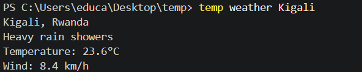
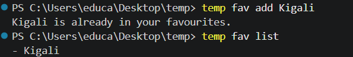
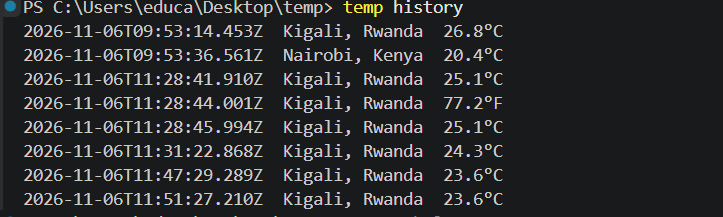
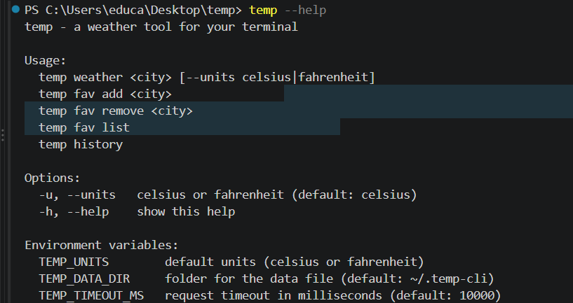
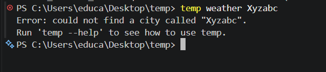

# temp

**temp** is a weather tool you run from the terminal.

```
$ temp weather Kigali
Kigali, Rwanda
Overcast
Temperature: 26.6°C
Wind: 8.1 km/h
```

## Features

- Current weather for any city in the world
- Celsius or Fahrenheit
- Favourite cities and lookup history, saved in a JSON file
- Settings through environment variables
- Friendly error messages and correct exit codes (no internet, timeout, city not found, bad input)

## Requirements

- Node.js 18 or newer (check with `node -v`)
- An internet connection (weather data comes from [Open-Meteo](https://open-meteo.com/), no API key needed)

## Install

```bash
git clone https://github.com/Iradukunda41/temp.git
cd temp
npm install
npm link
```

`npm link` creates a global command, so `temp` works from any folder. To remove it later, run `npm unlink -g temp`.

Check that it works:

```bash
temp --help
```

## Usage

### Get the weather

```bash
temp weather Kigali
temp weather "New York" --units fahrenheit
temp weather Nairobi -u celsius
```



### Favourites

```bash
temp fav add Kigali
temp fav list
temp fav remove Kigali
```



### History

Every successful `temp weather` lookup is saved. `temp history` shows the last 20.

```bash
temp history
```



### Help

```bash
temp --help
```



## Options

| Option | Meaning | Default |
|---|---|---|
| `-u`, `--units` | `celsius` or `fahrenheit` | `celsius` |
| `-h`, `--help` | show the help text | |

## Configuration (environment variables)

| Variable | Meaning | Default |
|---|---|---|
| `TEMP_UNITS` | default units when `--units` is not given | `celsius` |
| `TEMP_DATA_DIR` | folder where `data.json` is saved | `~/.temp-cli` |
| `TEMP_TIMEOUT_MS` | request timeout in milliseconds | `10000` |

The `--units` flag always wins over `TEMP_UNITS`.

PowerShell example:

```powershell
$env:TEMP_UNITS = "fahrenheit"
temp weather Kigali
```

Mac / Linux example:

```bash
TEMP_UNITS=fahrenheit temp weather Kigali
```

## Errors and exit codes

Exit code `0` means success. Any problem prints a short message to the error stream and exits with code `1`.

| Situation | Message | Exit code |
|---|---|---|
| Weather, list or history printed | (normal output) | 0 |
| No command, unknown command, unknown option | usage hint | 1 |
| No city given | `please give a city...` | 1 |
| Units not `celsius` or `fahrenheit` | `units must be ...` | 1 |
| City not found | `could not find a city called ...` | 1 |
| No internet | `could not reach the weather service` | 1 |
| Request too slow | `the request timed out` | 1 |
| Data file contains broken JSON | `the data file is damaged` | 1 |
| Favourite not in the list | `... is not in your favourites` | 1 |



## Where the data is saved

Favourites and history are stored in `~/.temp-cli/data.json` (for example `C:\Users\<you>\.temp-cli\data.json` on Windows):

```json
{
  "favourites": ["Kigali"],
  "history": [
    {
      "city": "Kigali",
      "country": "Rwanda",
      "temperature": 26.8,
      "units": "celsius",
      "time": "2026-11-06T09:53:14.453Z"
    }
  ],
  "settings": { "units": "celsius" }
}
```

## Project structure

```
temp/
  bin/temp.js      entry point: reads the command line and decides what to do
  src/api.js       the two web requests (geocoding, forecast) and error handling
  src/format.js    turns the weather data into readable text
  src/storage.js   reads and writes the JSON data file
  package.json     name, bin, scripts, engines
```

## How it works (walkthrough)

1. **Package setup.** The `bin` field in `package.json` ... The first line `#!/usr/bin/env node` ... I ran `npm link` so that ...

2. **Reading the input.** `util.parseArgs` ... The first word is the ... and the rest is ...

3. **Two requests.** First I call the geocoding API to get ... Then I call the forecast API with ... I use `await` because ...

4. **Errors.** If the internet is off, ... If the request is too slow, ... If the city does not exist, ... All of them exit with code ... because ...

5. **Saving data.** I save favourites and history in a file called ... It is stored in the folder ... If the file does not exist yet, ...

6. **Configuration.** The units come from the flag first, then ..., then ... I read environment variables with ...

## Data source

Weather and geocoding data from [Open-Meteo](https://open-meteo.com/).

## Author

Iradukunda Flora